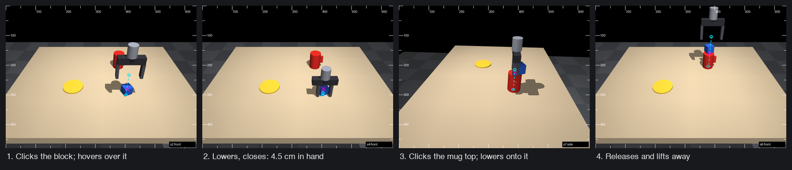
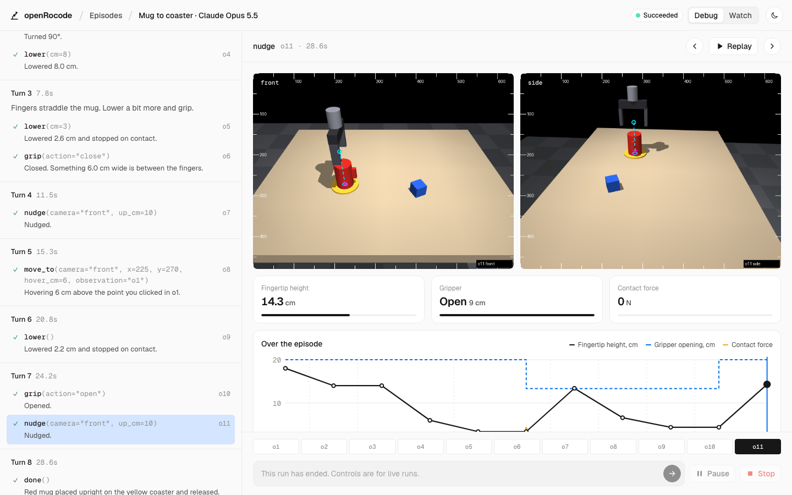
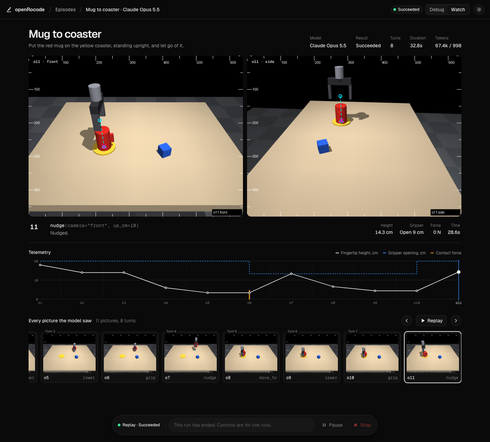

<h1 align="center">openRocode</h1>

<p align="center">
  <strong>Let multimodal models drive robots the way they use computers.</strong>
</p>

<p align="center">
  
  
  
  
</p>

<p align="center">
  
</p>
<p align="center"><sub>A real, unscripted episode: Claude Opus 5.5 stacks the block on the mug in 6 turns and 23 seconds. These are the pictures the model saw, with the gripper's fingertip (cyan) and its last click (magenta) drawn on.</sub></p>

openRocode is an open, minimal agent harness that turns robot control into **3D computer use**. The model looks at camera pictures, clicks where the gripper should go, nudges in directions it can see, or writes a short Python program for the parts that need loops and checks. The harness does all the geometry, enforces force and workspace limits on every motion, lets a human step in at any moment, and records everything.

**The model never sees or writes a world coordinate.** Depth, calibration and frames stay inside the harness; tools speak pixels, centimetres and "left in the front camera".

## Highlights

- **Point, don't compute.** `move_to(camera, x, y)` sends the gripper above whatever is under that pixel. Clicks are bound to the exact pictures the model saw, so a gripper that later blocks the view cannot change what was clicked.
- **Two ways to act, chosen by the model.** Call tools one step at a time, or hand a sequence to `run_code`. Every robot call a program makes goes through the same validation, safety hooks and emergency stop as a direct call.
- **Safety that does not depend on the model.** Every motion is force-guarded and workspace-checked by the body. Physical actions are never retried automatically. An action that stops early cancels the rest of that turn's actions.
- **A human in the loop.** While a run is going, type to the model, pause it, or emergency-stop it, from the terminal or the dashboard.
- **A dashboard for every run.** Watch a run live with both cameras, or step through a finished one turn by turn, in light or dark.
- **Any model.** Claude through the Anthropic API, or any OpenAI-compatible endpoint (OpenAI, Qwen, DeepSeek, vLLM, LiteLLM proxies).
- **Small and hackable.** A pi-style core of about 700 lines: loop, events, hooks, control channel. Tools, safety, recording and the robot itself are plug-ins.
- **Every episode is replayable.** An event log plus every picture the model was shown.

## Quick start

```bash
git clone https://github.com/wrencanfly/openRocode.git
cd openRocode/python
python -m venv .venv && source .venv/bin/activate
pip install -e '.[sim,agent,openai,dev]'

rocode demo        # a scripted episode, no API key: checks your install
pytest             # 28 tests, about 5 seconds, no API key
```

Then give a model the arm.

```bash
# Claude via the Anthropic API (ANTHROPIC_API_KEY, or `ant auth login`)
rocode run mug_to_coaster

# Any OpenAI-compatible endpoint
export OPENAI_API_KEY=...
export OPENAI_BASE_URL=https://your-endpoint/v1
rocode run mug_to_coaster --provider openai --model claude-opus-5-5
```

Add `--view` to watch and steer the run in the dashboard. `rocode tasks` lists the tasks; `rocode replay runs/<episode>` prints a recorded episode in the terminal.

## Dashboard

```bash
rocode run mug_to_coaster --view   # opens the dashboard on the live run
rocode view                        # browse every episode in ./runs, including runs still going
```

The home page lists every episode with its model, result, turns, duration and tokens. Each episode opens in one of two layouts:

- **Debug**: the turn-by-turn timeline (what the model said, each call, every program with its robot calls and output) beside both camera views, the readings for the selected step, and a telemetry chart of fingertip height, gripper opening and contact force.
- **Watch**: both cameras fill the page, with the telemetry chart and a strip of every picture the model saw underneath. A running episode opens here.

<p align="center">
  
</p>
<p align="center">
  
</p>

For a run started with `--view`, the bar at the bottom talks to the model, pauses it, or stops it, the same as typing in the terminal. Arrow keys step through pictures and the space bar replays. The dashboard is plain HTML and JavaScript served by Python's standard library: no build step, no Node. It listens on 127.0.0.1 only, and control requests need a token that only its own page carries.

## What a run looks like

A lightly trimmed excerpt from `rocode run mug_to_coaster` with Claude Opus 5.5. The model points once, then writes a program for the fiddly part: nudge, turn 90° so the fingers miss the handle, lower, grip, lift.

```text
── turn 1
   ▶ move_to {"camera": "front", "x": 379, "y": 165, "hover_cm": 5}
   ✓ Hovering 5 cm above the point you clicked in o1.  [o2]

── turn 2
   ▶ run_code
     │ print(robot.nudge("side", right_cm=1.5).text)
     │ print(robot.turn(90).text)
     │ r=robot.lower(7); print(r.text, r.height_cm)
      ✓ Nudged.  [o3]
      ✓ Turned 90°.  [o4]
      ✓ Lowered 7.0 cm.  [o5]

── turn 3
   model: Fingers straddle the mug in side view. Lower more and grip.
   ▶ run_code
     │ r=robot.lower(4); print(r.text)
     │ r=robot.grip("close"); print(r.text, r.holding)
     │ r=robot.nudge("front", up_cm=10); print(r.text)
      ✓ Lowered 3.6 cm and stopped on contact.  [o6]
      ✓ Closed. Something 6.0 cm wide is between the fingers.  [o7]
      ✓ Nudged.  [o8]
   ...
── ended: done after 6 steps, 6 turns, 22.5 s
   ground truth: success=True
```

## What the model gets

| Tool | What it does |
|---|---|
| `look()` | Fresh pictures from every camera. |
| `move_to(camera, x, y, hover_cm=8, observation=None)` | Hover above the surface point under that pixel. Rises, travels, descends; stops on contact. |
| `lower(cm=None)` | Straight down until contact, or by `cm`. |
| `nudge(camera, right_cm, away_cm, up_cm)` | Small move in directions as seen in that camera's picture. |
| `turn(degrees)` | Rotate the gripper about the vertical. |
| `grip("close" \| "open")` | Reports whether something is between the fingers, and how wide. |
| `run_code(code)` | Run a Python program against the same tools through a `robot` object. |
| `done(success, summary)` | End the episode. |

Every result says what actually happened (reached, touched something, blocked, refused), how high the fingertips are, what the gripper holds, and comes with annotated pictures labelled `o1`, `o2`, … Programs get the same facts as structured values:

```python
r = robot.lower()
if not r.touched:
    raise SystemExit("nothing under the gripper")
r = robot.grip("close")
print(r.holding, r.opening_cm, r.height_cm, r.stop)
```

`--policy tools|code|both` controls which of the two ways the model may act. The default is `both`.

## Stepping in

While `rocode run` is going, type into the terminal (or use the bar at the bottom of the dashboard):

| Input | Effect |
|---|---|
| any text | Passed to the model before its next decision ("not that one, the one on the left") |
| `/pause`, `/resume` | Hold the loop at the next safe point, then continue |
| `/stop` | Emergency stop: halts motion immediately and ends the episode |

## How it works

```text
  session      one episode: build the body, load extensions, run, score, record
     │
  core         agent loop · events · hooks · control channel        (knows no robots)
     │    ╲
  providers   extensions                                             (know no specific robot)
  Claude,     pointing tools · run_code · safety gate · recorder
  OpenAI-          │
  compatible     body          observe · move · rotate · grip · stop (knows no models)
                   │
            MuJoCo tabletop · (next: LIBERO, real arms)
```

- **Append-only history.** Nothing already sent to the model is edited, so prompt caches stay warm and Claude's thinking blocks stay valid. Old pictures are trimmed only by the provider's own mechanism (`--keep-images N`).
- **Hooks, not forks.** An extension can add tools, add prompt text, refuse or rewrite a call before it runs, edit a result after it runs, or watch the event stream.
- **Bodies are one small interface.** Adding a robot means implementing `info`, `observe`, `move`, `rotate`, `grip`, `stop` and `reset`. Nothing above that layer changes.

Design notes: [docs/design.md](docs/design.md) (goals and scope) and [docs/core-design.md](docs/core-design.md) (internals).

## Results so far

Single runs on the MuJoCo tabletop, not success rates. Every run below succeeded by the simulator's ground truth, which the model never sees.

| Task | Model | Turns | Time |
|---|---|---|---|
| `lift_block` | Claude Opus 5.5 | 4 | 13 s |
| `mug_to_coaster` | Claude Opus 5.5 | 6 | 23 s |
| `stack_block_on_mug` | Claude Opus 5.5 | 6 | 23 s |
| `mug_to_coaster` | Claude Sonnet 5.5 | 7 | 26 s |
| `mug_to_coaster` | GPT-6.1 Sol | 9 | 29 s |

## Project layout

```text
python/rocode/
  core/        loop, events, hooks, control channel, messages, tool contract
  providers/   anthropic.py, openai_compat.py, scripted.py
  body/        base.py (the body contract), mujoco_tabletop.py
  ext/         pointing.py, code.py (run_code), safety.py, recorder.py
  view/        the dashboard: episodes.py, server.py, static/ (HTML, CSS, JS)
  session.py   tasks.py   cli.py   demo.py
python/tests/  harness, provider and dashboard tests (no API key needed)
crates/        the earlier Rust prototype (see below)
docs/          design notes
```

## Status and roadmap

openRocode is **alpha**. What works today: the core, both providers, pointing tools, `run_code`, operator controls, recording, replay and the dashboard, on one MuJoCo tabletop with a floating gripper.

Known limits:

- No arm kinematics yet: the gripper floats, so reachability and joint limits are not modelled.
- `run_code` runs in a separate interpreter with call and time budgets, but it is not a security sandbox.
- No batch evaluation runner yet; one `rocode run` is one episode.

Next:

1. Batch evaluation across tasks, seeds and models.
2. A second body (LIBERO) to prove the body contract.
3. A Python SDK, and an MCP server so Claude Code, pi and other agents can drive a robot directly.
4. A simulated arm with real kinematics, then a first real-robot adapter.
5. Trained policies (VLAs) as tools.

## The Rust prototype

`crates/` holds the first prototype: a Rust harness with a 500 Hz safety arbiter, a terminal cockpit and flight recording. It is kept as groundwork for a hard real-time safety layer on physical robots and is not part of the Python harness.

```bash
cargo test                          # its own test suite
cargo run -p rocode-cli -- tui      # its terminal cockpit (offline scripted planner without an API key)
```

## Contributing

Issues and pull requests are welcome. Run `pytest` in `python/` before sending a change; tests need no API key. New robots belong in `rocode/body/`, new capabilities in `rocode/ext/`. Please keep the core small.
