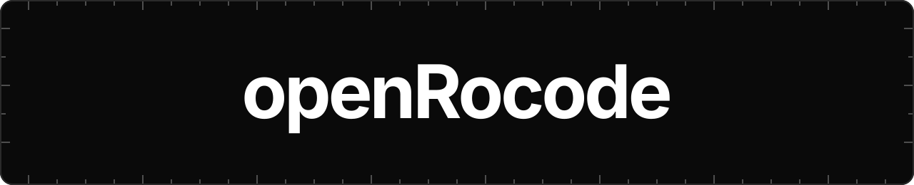
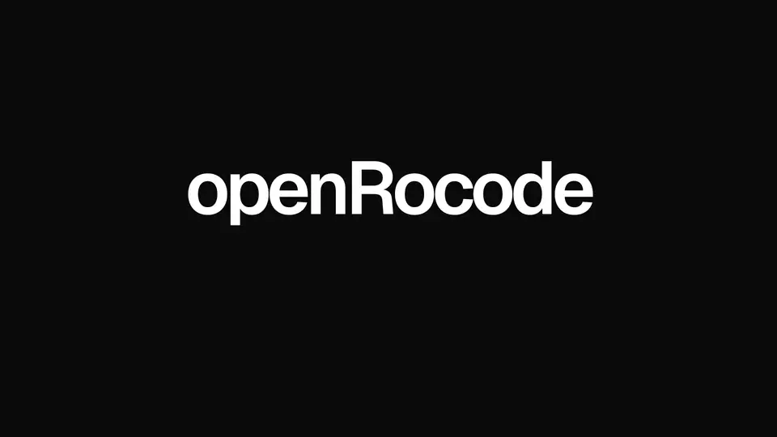
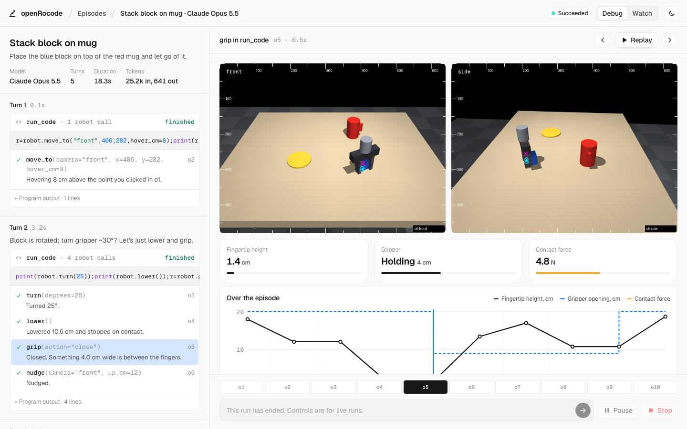
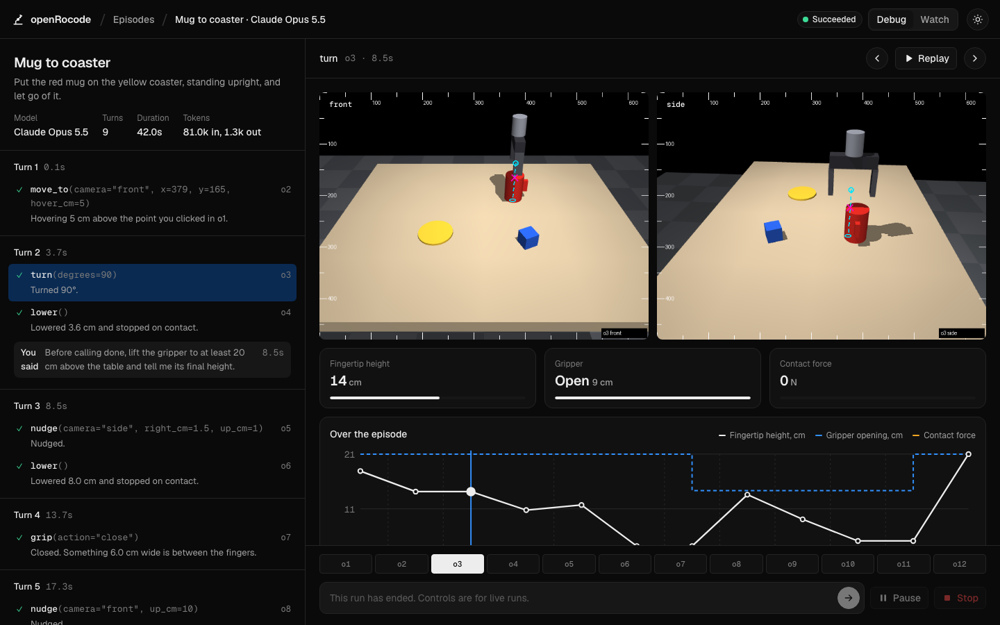
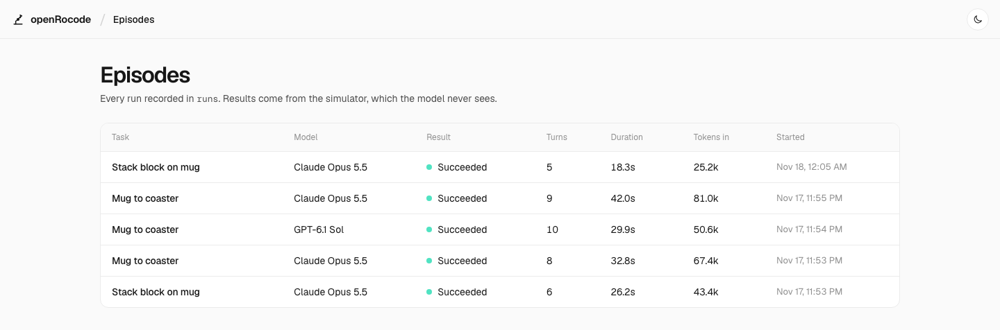
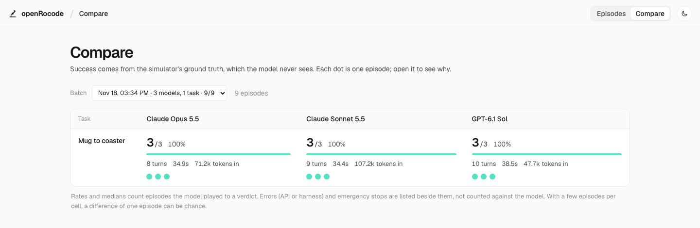
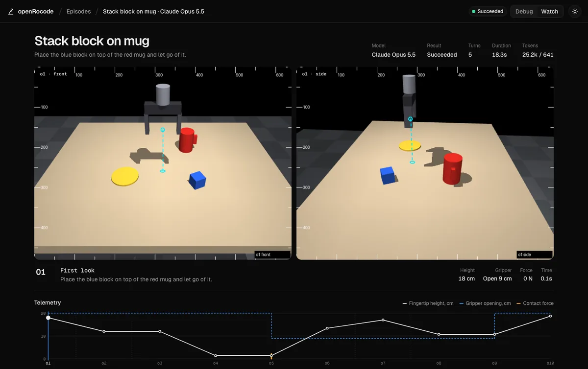

<p align="center">
  
</p>

<p align="center">
  <strong>Let multimodal models drive robots the way they use computers.</strong>
</p>

<p align="center">
  <a href="https://github.com/wrencanfly/openRocode/actions/workflows/tests.yml"></a>
  <a href="LICENSE"></a>
  
  
  
  
</p>

<p align="center">
  <a href="#quick-start">Quick start</a>&nbsp;&nbsp;&nbsp;
  <a href="#features">Features</a>&nbsp;&nbsp;&nbsp;
  <a href="#the-dashboard">Dashboard</a>&nbsp;&nbsp;&nbsp;
  <a href="#how-it-works">How it works</a>&nbsp;&nbsp;&nbsp;
  <a href="#status-and-roadmap">Roadmap</a>
</p>

<p align="center">
  <a href="docs/assets/openrocode-tour.mp4"></a>
</p>
<p align="center"><sub>Everything in this tour comes from real runs: the task sentence, each model's own words, the code, the pictures and the verdicts. <a href="docs/assets/openrocode-tour.mp4">Watch it in full quality (MP4)</a>.</sub></p>

openRocode is an open agent harness that turns robot control into **3D computer use**. The model looks at camera pictures, clicks where the gripper should go, nudges in directions it can see, or writes a short Python program for the parts that need loops and checks. The harness does the geometry, guards every motion, lets a person step in at any moment, and records everything.

**The model never sees or writes a world coordinate.** Depth, calibration and frames stay inside the harness. Tools speak pixels, centimetres and "left in the front camera".

## Quick start

```bash
git clone https://github.com/wrencanfly/openRocode.git
cd openRocode
python -m venv .venv && source .venv/bin/activate
pip install -e '.[sim,agent,openai,dev]'

rocode demo        # a scripted episode, no API key: checks your install
pytest             # 40 tests, about 8 seconds, no API key
```

Then give a model the arm, and watch it in the dashboard:

```bash
# Claude via the Anthropic API (ANTHROPIC_API_KEY, or `ant auth login`)
rocode run mug_to_coaster --view

# Any OpenAI-compatible endpoint: OpenAI, Qwen, DeepSeek, vLLM, LiteLLM proxies
export OPENAI_API_KEY=...
export OPENAI_BASE_URL=https://your-endpoint/v1
rocode run mug_to_coaster --view --provider openai --model claude-opus-5-5
```

`rocode tasks` lists the tasks. `rocode view` browses every recorded episode. `rocode replay runs/<episode>` prints one in the terminal.

Compare models on the same tasks, with several object layouts each:

```bash
rocode bench mug_to_coaster stack_block_on_mug \
  --model openai:claude-opus-5-5 --model openai:gpt-6.1-sol --repeat 3 --view
```

## Features

### Point, don't compute

`move_to(camera, x, y)` sends the gripper above whatever is under that pixel. Each picture is labelled (`o1`, `o2`, …) and a click is bound to the exact pictures the model looked at, so a gripper that later blocks the view cannot change what was clicked. Results come back as annotated pictures: the fingertip, its drop line to the table, and the last click are drawn on.

### Tools or programs, chosen by the model

The model can act one step at a time, or hand a sequence to `run_code` when it needs loops, retries or checks on the readings. Every robot call a program makes goes through the same validation, safety hooks and emergency stop as a direct call. Programs cannot see pictures, so the model looks first and then writes code against what it saw.

<p align="center">
  
</p>

### Step in at any time

While a run is going, tell the model something ("not that one, the one on the left"), pause it, or stop it, from the terminal or the dashboard. Messages reach the model before its next decision and stay in the record.

<p align="center">
  
</p>

### Safety that does not depend on the model

Every motion is force-guarded and workspace-checked by the body. Physical actions are never retried automatically, and an action that stops early cancels the rest of that turn's actions. An emergency stop halts motion immediately, including inside a running program.

### Any model, one harness

Claude through the Anthropic API, or any OpenAI-compatible endpoint. History is append-only, so prompt caches stay warm and Claude's thinking blocks stay valid. Swap the model with a flag; nothing else changes. On OpenAI-compatible endpoints, `--reasoning` also sends `--effort` as `reasoning_effort` and records the model's reasoning summary.

### Every run is a trace

Each episode is recorded as a trace: every turn, the model's reasoning when the provider returns it, every tool call (nested under the program that made it), every picture the model was shown, what the robot actually did, what a person said, and the simulator's ground-truth verdict, which the model never sees. The [trace format](docs/trace-format.md) is versioned and documented, and `rocode.trace` reads it, so your own tools can too.

<p align="center">
  
</p>

### Compare models on the same tasks

`rocode bench` runs tasks × models × seeds one episode at a time, each seed moving the objects a few centimetres. The dashboard's Compare page shows successes, median turns, time and tokens for each pair, one dot per episode that opens its trace, and why each failed one failed. API or harness errors are listed beside the rate, not counted against the model.

<p align="center">
  
</p>

### Small and hackable

A pi-style core of about 700 lines: loop, events, hooks and a control channel. Tools, safety, recording, the dashboard and the robot itself are plug-ins.

## The dashboard

```bash
rocode run mug_to_coaster --view   # opens on the live run, with controls
rocode view                        # every episode in ./runs, including runs still going
```

- **Episodes**: every run with its model, result, turns, duration and tokens.
- **Compare**: tasks against models for a `rocode bench` batch, or for everything recorded: successes, median turns, time and tokens, one dot per episode that opens it, and why each failed one failed.
- **Debug**: the turn-by-turn timeline (what the model said, each call, each program with its robot calls and output) beside both cameras, the readings for the selected step, and a telemetry chart.
- **Watch**: both cameras fill the page, with the telemetry chart and a strip of every picture the model saw. A running episode opens here.

<p align="center">
  
</p>

Light and dark themes, arrow keys to step, space to replay, and links that open on a given step (`#/e/<episode>?mode=watch&step=5`). It is plain HTML and JavaScript served by Python's standard library: no build step, no Node. It listens on 127.0.0.1 only, and control requests need a token that only its own page carries.

## What a run looks like

A lightly trimmed excerpt from `rocode run mug_to_coaster` with Claude Opus 5.5. The model points once, then writes a program for the fiddly part: nudge, turn 90° so the fingers miss the handle, lower, grip, lift.

```text
── turn 1
   ▶ move_to {"camera": "front", "x": 379, "y": 165, "hover_cm": 5}
   ✓ Hovering 5 cm above the point you clicked in o1.  [o2]

── turn 2
   ▶ run_code
     │ print(robot.nudge("side", right_cm=1.5).text)
     │ print(robot.turn(90).text)
     │ r=robot.lower(7); print(r.text, r.height_cm)
      ✓ Nudged.  [o3]
      ✓ Turned 90°.  [o4]
      ✓ Lowered 7.0 cm.  [o5]

── turn 3
   model: Fingers straddle the mug in side view. Lower more and grip.
   ▶ run_code
     │ r=robot.lower(4); print(r.text)
     │ r=robot.grip("close"); print(r.text, r.holding)
     │ r=robot.nudge("front", up_cm=10); print(r.text)
      ✓ Lowered 3.6 cm and stopped on contact.  [o6]
      ✓ Closed. Something 6.0 cm wide is between the fingers.  [o7]
      ✓ Nudged.  [o8]
   ...
── ended: done after 6 steps, 6 turns, 22.5 s
   ground truth: success=True
```

## The model's tools

| Tool | What it does |
|---|---|
| `look()` | Fresh pictures from every camera. |
| `move_to(camera, x, y, hover_cm=8, observation=None)` | Hover above the surface point under that pixel. Rises, travels, descends; stops on contact. |
| `lower(cm=None)` | Straight down until contact, or by `cm`. |
| `nudge(camera, right_cm, away_cm, up_cm)` | A small move in directions as seen in that camera's picture. |
| `turn(degrees)` | Rotate the gripper about the vertical. |
| `grip("close" \| "open")` | Reports whether something is between the fingers, and how wide. |
| `run_code(code)` | Run a Python program against the same tools through a `robot` object. |
| `done(success, summary)` | End the episode. |

Every result says what actually happened (reached, touched something, blocked, refused), how high the fingertips are and what the gripper holds. Programs get the same facts as values:

```python
r = robot.lower()
if not r.touched:
    raise SystemExit("nothing under the gripper")
r = robot.grip("close")
print(r.holding, r.opening_cm, r.height_cm, r.stop)
```

`--policy tools|code|both` sets how the model may act. The default is `both`.

## How it works

<p align="center">
  
</p>

- **Append-only history.** Nothing already sent to the model is edited. Old pictures are trimmed only by the provider's own mechanism (`--keep-images N`).
- **Hooks, not forks.** An extension can add tools and prompt text, refuse or rewrite a call before it runs, change a result after it runs, or watch the event stream.
- **Bodies are one small interface.** Adding a robot means implementing `info`, `observe`, `move`, `rotate`, `grip`, `stop`, `reset`, `ground_truth` and `close`. Nothing above that layer changes.

Design notes: [docs/design.md](docs/design.md) (goals and scope) and [docs/core-design.md](docs/core-design.md) (internals). The dashboard follows [DESIGN.md](DESIGN.md).

## Results so far

`rocode bench mug_to_coaster --repeat 3` with three models, through an OpenAI-compatible proxy at each model's default reasoning effort. Every episode was judged by the simulator's ground truth. Nine runs are a small sample, not a leaderboard.

| Model | Succeeded | Median turns | Median time | Mean input tokens |
|---|---|---|---|---|
| Claude Opus 5.5 | 3/3 | 8 | 34.9 s | 71k |
| Claude Sonnet 5.5 | 3/3 | 9 | 34.4 s | 107k |
| GPT-6.1 Sol | 3/3 | 10 | 38.5 s | 48k |

Earlier single runs, all successful:

| Task | Model | How it acted | Turns | Time |
|---|---|---|---|---|
| `lift_block` | Claude Opus 5.5 | tools | 4 | 13 s |
| `mug_to_coaster` | Claude Opus 5.5 | tools and programs | 6 | 23 s |
| `stack_block_on_mug` | Claude Opus 5.5 | tools | 6 | 23 s |
| `stack_block_on_mug` | Claude Opus 5.5 | programs only | 5 | 18 s |
| `mug_to_coaster` | Claude Sonnet 5.5 | tools | 7 | 26 s |
| `mug_to_coaster` | GPT-6.1 Sol | tools | 9 | 29 s |

## Project layout

```text
rocode/
  core/        loop, events, hooks, control channel, messages, tool contract
  providers/   anthropic.py, openai_compat.py, scripted.py
  body/        base.py (the body contract), mujoco_tabletop.py
  ext/         pointing.py, code.py (run_code), safety.py, recorder.py
  view/        the dashboard: episodes.py, compare.py, server.py, static/
  session.py   bench.py   trace.py   tasks.py   cli.py   demo.py
tests/         harness, provider, trace, bench and dashboard tests (no API key needed)
docs/          trace format, design notes and images
```

## Status and roadmap

openRocode is **alpha**. It works today on one MuJoCo tabletop with a floating gripper: the core, both providers, pointing tools, `run_code`, operator controls, traces, batch comparison, replay and the dashboard.

Known limits:

- No arm kinematics yet: the gripper floats, so reachability and joint limits are not modelled.
- `run_code` runs in a separate interpreter with call and time budgets, but it is not a security sandbox.
- Four tasks on one scene. Seeds move the objects a few centimetres; they do not change the scene.

Next:

1. A second body (LIBERO) to prove the body contract, with its tasks in `rocode bench`.
2. Export traces to OpenTelemetry, so Langfuse, Phoenix and other LLM observability tools can show them.
3. A Python SDK, and an MCP server so Claude Code, pi and other agents can drive a robot directly.
4. A simulated arm with real kinematics, then a first real-robot adapter.
5. A hard real-time safety loop beside physical robots.
6. Trained policies (VLAs) as tools.

## Contributing

openRocode is early, and focused contributions change a lot. Good places to start:

| You want to | Start in | Guide |
|---|---|---|
| Connect a robot or simulator | `rocode/body/` | [Add a body](CONTRIBUTING.md#add-a-robot-or-simulator-a-body) |
| Add a task | `rocode/tasks.py` | [Add a task](CONTRIBUTING.md#add-a-task) |
| Support another model API | `rocode/providers/` | [Add a provider](CONTRIBUTING.md#add-a-model-provider) |
| Add a capability or tool | `rocode/ext/` | [Rules the harness depends on](CONTRIBUTING.md#rules-the-harness-depends-on) |
| Improve the dashboard | `rocode/view/static/` | [DESIGN.md](DESIGN.md) |
| Build tools on recorded runs | `rocode/trace.py` | [Trace format](docs/trace-format.md) |

Read [CONTRIBUTING.md](CONTRIBUTING.md) before your first pull request: it covers setup, the five rules every change keeps, and what a pull request needs. Issues labelled [`good first issue`](https://github.com/wrencanfly/openRocode/labels/good%20first%20issue) are ready to pick up. Tests need no API key.

## License

[Apache-2.0](LICENSE).
